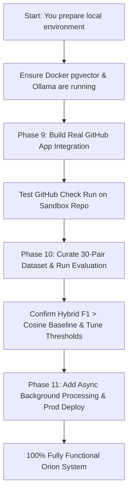

# Orion — Remaining Phases & Completion Blueprint

This document specifies the remaining phases, architecture, and manual action items required to take **Orion** from its current prototype state (Phases 1–8 complete) to a **100% fully functional, production-ready AI-powered Requirements Traceability Matrix system**.

---

## 1. System Status Snapshot (Where We Are Now)

| Phase | Component | Status | Verification Reference |
|---|---|:---:|---|
| **Pre-Phase 0** | Core Decisions (`@traces` link, risk formula, constraint rules) | **Done** | `orion_build_phases.md` |
| **Phase 1** | PostgreSQL + pgvector Database Schema & Migrations | **Done** | `scripts/verify_phase1.py` |
| **Phase 2** | FastAPI Ingestion Webhooks (Jira, GitHub simulate) & Signatures | **Done** | `scripts/verify_phase2.py` |
| **Phase 3** | Dual-Sided Structural Extraction (AST assertions + Regex constraints) | **Done** | `scripts/verify_phase3.py` |
| **Phase 4** | Semantic Vector Engine (BGE-small-en-v1.5 embeddings & fallback) | **Done** | `scripts/verify_phase4.py` |
| **Phase 5** | Structural Matcher & Hybrid Risk Engine (`0.6*sem + 0.4*struct`) | **Done** | `scripts/verify_phase5.py` |
| **Phase 6** | Requirement-Diff Tracking & Jira Changelog Parsing | **Done** | `scripts/verify_phase6.py` |
| **Phase 7** | Evidence-Grounded LLM Verbalization (Ollama Llama 3.1 8B) | **Done** | `scripts/verify_phase7.py` |
| **Phase 8** | Interactive Dashboard (React + Vite, RTM table, Heatmap, Slider) | **Done** | `scripts/verify_phase8.py` |
| **Phase 9** | Real GitHub App Integration & Pull Request Check Runs | **Pending** | *Specification below* |
| **Phase 10** | Benchmark Evaluation Framework (30-Pair Dataset vs Baselines) | **Pending** | *Specification below* |
| **Phase 11** | Production Async Pipeline & Real Ingestion Connectors | **Pending** | *Specification below* |

---

## 2. What YOU Need to Do From Your Side (Human Action Checklist)

Below are the tasks that **only you** (as the human developer/project owner) can perform, because they require accounts, local hardware setup, private keys, or domain judgment.

### A. Infrastructure & Local Services Setup
- [ ] **1. Ensure PostgreSQL + pgvector is Running:**
  - Start the container:
    ```powershell
    docker-compose up -d
    ```
  - Verify container status with `docker ps` (service `orion-db` listening on port `5432`).
  - Run database migrations:
    ```powershell
    alembic upgrade head
    ```
- [ ] **2. Install & Start Ollama for Evidence Verbalization (Phase 7):**
  - Download and install [Ollama](https://ollama.ai/).
  - Pull the required model in terminal:
    ```powershell
    ollama pull llama3.1:8b
    ```
  - Verify it is responding locally at `http://localhost:11434/api/tags`.
- [ ] **3. Run Frontend & Backend Local Dev Servers:**
  - Backend:
    ```powershell
    uvicorn orion.app:app --reload --port 8000
    ```
  - Frontend:
    ```powershell
    cd frontend
    npm install
    npm run dev
    ```
  - Access dashboard at `http://localhost:5173`.

---

### B. GitHub App Creation & Configuration (Required for Phase 9)
To enable real PR checks on GitHub pull requests without using simulation mode, create a GitHub App:

- [ ] **1. Create GitHub App in your GitHub Account:**
  - Go to **GitHub Settings** -> **Developer Settings** -> **GitHub Apps** -> **New GitHub App**.
  - **App Name**: e.g., `Orion-Traceability-Engine`
  - **Homepage URL**: `http://localhost:8000` (or your repo URL)
  - **Webhook URL**: Your webhook receiver (for local testing, use a tunnel like [smee.io](https://smee.io) or ngrok).
  - **Webhook Secret**: Generate a secure string and record it.
- [ ] **2. Configure Permissions:**
  - Repository Permissions:
    - **Checks**: `Read and write` (to post Check Runs with risk status and audit summaries)
    - **Pull requests**: `Read and write` (to read PR diffs and comment on PRs)
    - **Contents**: `Read-only` (to fetch test file source code from commits/branches)
  - Subscribe to Events:
    - `Pull request` (opened, synchronize, reopened)
    - `Push`
- [ ] **3. Generate Private Key:**
  - Under App settings, click **Generate a private key**.
  - Download the `.pem` file and save it securely (e.g. `orion_app_private_key.pem`).
  - Note your **App ID** and **Client ID**.
- [ ] **4. Install App to a Test Repository:**
  - Click **Install App** in the left sidebar and select a sandbox repo containing test files.
  - Note your **Installation ID** (from the URL query parameters).
- [ ] **5. Add Keys to `.env`:**
  ```env
  GITHUB_APP_ID=123456
  GITHUB_APP_PRIVATE_KEY_PATH=./secrets/orion_private_key.pem
  GITHUB_WEBHOOK_SECRET=your-webhook-secret
  ```

---

### C. Jira REST API & Token Setup (For Backfill & Bi-Directional Sync)
Webhooks only fire when a ticket is actively modified. To backfill existing requirements and post drift alerts back onto Jira tickets, you need a Jira API token:

- [ ] **1. Generate Atlassian API Token:**
  - Go to [id.atlassian.com/manage-profile/security/api-tokens](https://id.atlassian.com/manage-profile/security/api-tokens).
  - Click **Create API token**, label it `orion-rtm-engine`, and copy the token.
- [ ] **2. Add Jira API Settings to `.env`:**
  ```env
  JIRA_BASE_URL=https://your-domain.atlassian.net
  JIRA_USER_EMAIL=you@example.com
  JIRA_API_TOKEN=your-atlassian-api-token
  JIRA_PROJECT_KEY=REQ
  ```

---

### D. Evaluation Benchmark Dataset Labeling (Required for Phase 10)
In Phase 5, 15 synthetic pairs were verified. Phase 10 requires the full **30-pair ground-truth benchmark dataset** (10 Covered, 10 Partial, 10 Drifted) to evaluate precision/recall:

- [ ] **Review and Curate the 30 Pairs:**
  - 10 **Covered**: Requirement constraints match test assertions and semantic descriptions closely.
  - 10 **Partial**: Test tests the general feature/function, but is missing specific edge-cases, boundary values, or throughput limits mentioned in the requirement.
  - 10 **Drifted**: Requirement changed (e.g. threshold updated, new constraint added, SLA tightened), but the test has not been updated or tests outdated logic.
  - Store these in `orion/evaluation/data/benchmark_30.json` (template will be generated in Phase 10).

---

## 3. Detailed Specification of Remaining Phases

---

### Phase 9 — Real GitHub App Integration & PR Check Runs

#### Goal
Replace the simulated `/api/v1/github` webhook with a real GitHub App client that authenticates via JWT, intercepts PR events, fetches changed test files using the GitHub REST API, evaluates traceability with Orion's hybrid risk engine, and publishes a native **GitHub Check Run** directly on the PR.

#### What to Build

1. **GitHub App Authentication Module (`orion/github/auth.py`):**
   - Mint RS256 JWT signed with the GitHub App private key (`.pem`), with 10-minute expiry.
   - Exchange JWT for an **Installation Access Token** via `POST https://api.github.com/app/installations/{installation_id}/access_tokens`.
   - Token caching with automatic refresh before expiration.

2. **GitHub API Client (`orion/github/client.py`):**
   - Fetch files changed in a Pull Request (`GET /repos/{owner}/{repo}/pulls/{pull_number}/files`).
   - Fetch raw file blob content for touched `@traces("REQ-...")` test files (`GET /repos/{owner}/{repo}/contents/{path}?ref={head_sha}`).
   - Create and update GitHub Check Runs:
     - `POST /repos/{owner}/{repo}/check-runs`
     - Status: `in_progress` -> `completed`
     - Conclusion mapping:
       - `Covered` -> `success`
       - `Partial` -> `neutral` (warning with missing assertions)
       - `Drifted` -> `failure` (action required with audit summary)
     - Output: Title, Markdown summary, and line-level annotations pointing to drifted assertions.

3. **Webhook Handler for Pull Requests (`orion/github/routes.py`):**
   - Intercept `pull_request` (`opened`, `synchronize`, `reopened`) events.
   - Verify `X-Hub-Signature-256`.
   - Filter changed files ending with `test_*.py` or `*_test.py`.
   - Execute extraction, embedding, and hybrid classification.
   - Trigger Phase 7 LLM verbalization for Partial/Drifted cases.
   - Post Check Run report.

#### Verification Criteria (`scripts/verify_phase9.py`)
- Unit test: JWT generation and token exchange mock pass cleanly.
- Integration test: Mock PR webhook creates a Check Run payload with correct conclusion, scores, and markdown summary.
- Live test (with test repo): Open a PR altering an assertion value; verify GitHub shows the Orion Check Run with status `failure` / `neutral` and the verbalized explanation.

---

### Phase 10 — Evaluation Framework & Precision/Recall Benchmark

#### Goal
Scientifically validate that Orion's **Hybrid Risk Engine** (`0.6 * semantic + 0.4 * structural`) outperforms a pure Cosine-only baseline on the 30-pair ground truth dataset, and calibrate optimal thresholds.

#### What to Build

1. **Benchmark Ground-Truth Dataset (`orion/evaluation/data/benchmark_30.json`):**
   - 30 curated pairs:
     - 10 `Covered`
     - 10 `Partial`
     - 10 `Drifted`
   - Each entry contains: `id`, `label`, `requirement_title`, `requirement_text`, `test_code`, and expected drift reasons.

2. **Evaluation Harness (`orion/evaluation/evaluator.py`):**
   - Runs two evaluation pipelines over the 30 pairs:
     - **Baseline (Cosine-only)**: Embeds requirement and test text; classifies using similarity thresholds alone.
     - **Orion Hybrid Engine**: Runs requirement constraint extraction + AST assertion extraction + structural matching + BGE-small embedding + formula.
   - Computes:
     - Confusion matrices for both pipelines.
     - Per-class and Macro-averaged **Precision**, **Recall**, and **F1-Score**.
     - Runtime latency per pair.

3. **Threshold Calibration Tool (`scripts/tune_thresholds.py`):**
   - Grid-search script exploring:
     - Semantic weight $w_{sem} \in [0.4, 0.8]$ vs Structural weight $w_{struct} \in [0.2, 0.6]$
     - Covered threshold $\theta_{cov} \in [0.70, 0.85]$
     - Drifted threshold $\theta_{drift} \in [0.30, 0.50]$
   - Finds parameters maximizing Macro-F1.

#### Verification Criteria (`scripts/verify_phase10.py`)
- Benchmark runs across all 30 pairs.
- Orion Hybrid Engine achieves higher Macro-F1 than Cosine-only baseline (demonstrating structural extraction catches semantic drift that embeddings miss).
- Produces markdown evaluation summary report (`evaluation_report.md`).

---

### Phase 11 — Production Pipeline & Operational Hardening

#### Goal
Make Orion robust against production edge cases, slow network calls, and timeout limits (GitHub webhooks require a 200 OK within 10 seconds).

#### What to Build

1. **Asynchronous Webhook Processing (`BackgroundTasks` or Redis/Celery):**
   - The webhook endpoint immediately validates HMAC-SHA256 signature and enqueues the PR/push event, returning `202 Accepted` within 200ms.
   - Worker processes AST extraction, embeddings, and LLM verbalization asynchronously.
   - Updates GitHub Check Run upon completion.

2. **Jira REST API Client & Bi-Directional Synchronization (`orion/jira/client.py`):**
   - **Why Webhooks alone aren't enough**: Webhooks only trigger on live edits; they cannot import existing tickets or write back to Jira.
   - **Historical Backfill / Bulk Import (`POST /api/v1/jira/sync`)**:
     - Query Jira issues via JQL (e.g., `project = "REQ" AND issuetype in (Story, Requirement)`).
     - Fetch full issue text, custom Acceptance Criteria fields, and parse Atlassian Document Format (ADF) into clean requirement text.
     - Upsert all existing requirements into the Orion database on day one.
   - **Bi-Directional Drift Alerts (Writing Back to Jira)**:
     - When the Orion Hybrid Engine detects that a requirement is `Drifted` or `Partial`, post an automated audit comment to the Jira issue:
       > *"⚠️ **Orion Traceability Alert**: Requirement updated to `< 100ms`, but linked test `test_api_latency` still asserts `< 200ms`. Status: **Drifted** (Risk: 0.32)."*
     - Update issue labels (e.g. `rtm-drifted`, `rtm-covered`) or custom fields so Product Managers and QA leads can see traceability status directly inside Jira.
   - **On-Demand Single Ticket Refresh**:
     - Allows dashboard users to click "Refresh from Jira" for any specific requirement key (e.g. `REQ-101`).

3. **Production Deployment & Dockerization:**
   - Multi-stage Dockerfile for FastAPI backend.
   - Dockerfile / Nginx for compiled React frontend.
   - Unified `docker-compose.prod.yml` running:
     - PostgreSQL + pgvector
     - Orion Backend API
     - Orion Webhook Worker
     - Frontend Dashboard
     - (Optional) Ollama or OpenAI/vLLM endpoint integration.

---

## 4. Execution Order & Recommended Next Steps



### Next Immediate Step
Tell the agent when you're ready to start **Phase 9 (GitHub App Integration)** or if you want to start with **Phase 10 (Evaluation Benchmark Dataset & Harness)** first.
